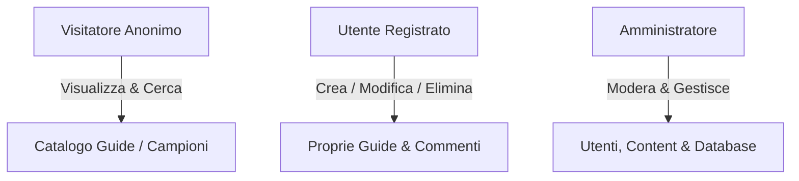

# TechWeb
# ⚔️ Rift Academy — League of Legends Guide & Build Portal


> **Rift Academy** è una piattaforma web dinamica e responsive progettata per la community di League of Legends. Sviluppata come progetto d'esame per il corso di **Tecnologie Web** presso l'**Università degli Studi di Padova**.

---

## 📌 Indice
- [Descrizione del Progetto](#-descrizione-del-progetto)
- [Tech Stack & Architettura](#-tech-stack--architettura)
- [Funzionalità & Ruoli Utente](#-funzionalità--ruoli-utente)
- [Struttura del Repository](#-struttura-del-repository)
- [Sicurezza & Accessibilità](#-sicurezza--accessibilità)
- [Guida all'Installazione](#-guida-allinstallazione)
- [Credenziali di Test](#-credenziali-di-test)

---

## 📖 Descrizione del Progetto

Rift Academy offre agli appassionati di League of Legends un ambiente interattivo per:
- 📖 **Consultare e creare guide** strategiche complete per ogni campione.
- 🛡️ **Pianificare build** ottimizzate per item e rune.
- 💬 **Interagire** con la community tramite voti e commenti.
- ⚙️ **Moderare i contenuti** tramite un pannello di amministrazione dedicato.

---

## 🛠️ Tech Stack & Architettura

Il progetto segue una rigida **architettura a tre livelli** per garantire la completa separazione tra contenuto, presentazione e comportamento:

| Livello | Tecnologia | Dettagli di Implementazione |
| :--- | :--- | :--- |
| **Frontend** | HTML5 Semantico | Accessibilità elevata, struttura valida XML / HTML5. |
| **Styling** | CSS3 (Pure) | Flexbox & CSS Grid responsive, zero framework esterni. |
| **Client Script** | Vanilla JS | Validazione form lato client, dinamismo ed elementi UX. |
| **Backend** | PHP (7.4+) | Operazioni CRUD, gestione sessioni e ruoli utente. |
| **Database** | MySQL / MariaDB | Struttura relazionale progettata in **Terza Forma Normale (3FN)**. |

---

## 👥 Funzionalità & Ruoli Utente



### 1. 🌐 Visitatore (Anonimo)
- Esplorazione della **Home Page** con guide in evidenza.
- Consultazione del **catalogo campioni** filtrabile per ruolo (*Top, Mid, Jungle, ADC, Support*).
- Lettura dei dettagli delle guide e dei commenti.

### 2. 👤 Utente Registrato (`user`)
- **Autenticazione:** Registrazione e Login sicuro.
- **Operazioni CRUD:** 
  - **Create:** Pubblicazione di nuove guide con campi di testo libero per le strategie.
  - **Update:** Modifica delle proprie guide pubblicate.
  - **Delete:** Cancellazione delle proprie guide.
- **Interattività:** Inserimento di commenti e valutazioni.

### 3. 🛡️ Amministratore (`admin`)
- **Dashboard Riservata:** Accesso al pannello di controllo amatoriale/gestionale.
- **Moderazione:** Eliminazione immediata di contenuti inappropriati o offensivi.
- **Gestione Utenti:** Blocco e sospensione degli account.
- **Gestione Game Data:** Inserimento e aggiornamento dei campioni e degli oggetti nel database.

---

## 📂 Struttura del Repository

```plaintext
tecweb_project/
├── 📁 admin/            # Dashboard e script riservati all'amministratore
├── 📁 assets/           # Immagini, icone e avatar dei campioni
├── 📁 css/              # Fogli di stile CSS3 (global, responsive, print)
├── 📁 includes/         # Moduli PHP riutilizzabili (header, footer, db_connect)
├── 📁 js/               # Script Vanilla JS per validazione client-side e UX
├── 📁 sql/              # Dump SQL per l'inizializzazione del Database
├── 📄 index.php         # Entry point della piattaforma
├── 📄 champions.php     # Catalogo campioni e filtri
├── 📄 create_guide.php  # Form creazione guida (campo testo libero)
├── 📄 guide_detail.php  # Dettaglio guida e sezione commenti
└── 📄 relazione.pdf     # Documento di relazione per la consegna dell'esame
```

---

## 🔒 Sicurezza & Accessibilità

> [!IMPORTANT]  
> Il progetto rispetta appieno le linee guida e le specifiche del corso di Tecnologie Web.

- **🛡️ Sicurezza Backend:**
  - Previsti **Prepared Statements** (PDO) per impedire attacchi **SQL Injection**.
  - Sanificazione degli input con `htmlspecialchars()` per la prevenzione di vulnerabilità **XSS**.
  - Password salvate tramite hashing sicuro.
- **♿ Accessibilità & UX:**
  - Piena navigabilità tramite tastiera e supporto agli screen-reader (attributi ARIA).
  - Layout nativamente fluido e responsive compatibile con dispositivi mobile, tablet e desktop.
  - Presenza di un foglio di stile dedicato alla stampa (`print.css`).

---

## 🚀 Guida all'Installazione

### Requisiti Preliminari
- Web Server (**Apache** o **Nginx**) con PHP 7.4 o superiore.
- Server **MySQL / MariaDB**.
- Ambiente locale consigliato: **XAMPP**, **WAMP** o **Docker**.

### Passaggi per l'esecuzione in locale

1. **Clona la repository:**
   ```bash
   git clone https://github.com/tuo-username/rift-academy.git
   cd rift-academy
   ```

2. **Importa il Database:**
   - Apri `phpMyAdmin` (o il tuo client MySQL).
   - Crea un database denominato `rift_academy_db`.
   - Importa lo script contenuto nel file `sql/database_dump.sql`.

3. **Configura la Connessione:**
   - Apri il file `includes/db_connect.php` e imposta le tue credenziali locali:
     ```php
     define('DB_HOST', 'localhost');
     define('DB_USER', 'root');
     define('DB_PASS', '');
     define('DB_NAME', 'rift_academy_db');
     ```

4. **Avvia l'applicazione:**
   - Copia i file nella cartella `htdocs` (o root del web server).
   - Apri il browser all'indirizzo `http://localhost/rift-academy`.

---

## 🔑 Credenziali di Test

> [!NOTE]  
> Credenziali predefinite fornite per la valutazione del progetto come da specifiche d'esame:

| Ruolo | Username | Password | Permessi |
| :--- | :--- | :--- | :--- |
| **Amministratore** | `admin` | `AdminPassword123!` | Accesso completo, moderazione e gestione DB |
| **Utente Semplice** | `user` | `UserPassword123!` | Creazione, modifica ed eliminazione delle proprie guide |

---

## 👨‍💻 Autori & Corso

Progetto sviluppato dal gruppo di lavoro per l'insegnamento di **Tecnologie Web**  
**Università degli Studi di Padova** — *Anno Accademico 2025/2026*